

  

  <b>A portable Windows control panel for Rust dedicated servers.</b> 
  Install, run, update, back up and moderate every server from one window, with no account or subscription.

  
  
  
  

  <a href="#quick-start">Quick start</a> ·
  <a href="#a-look-around">Screenshots</a> ·
  <a href="#features">Features</a> ·
  <a href="docs/admin-guide.md">Admin guide</a> ·
  <a href="CHANGELOG.md">Changelog</a>

  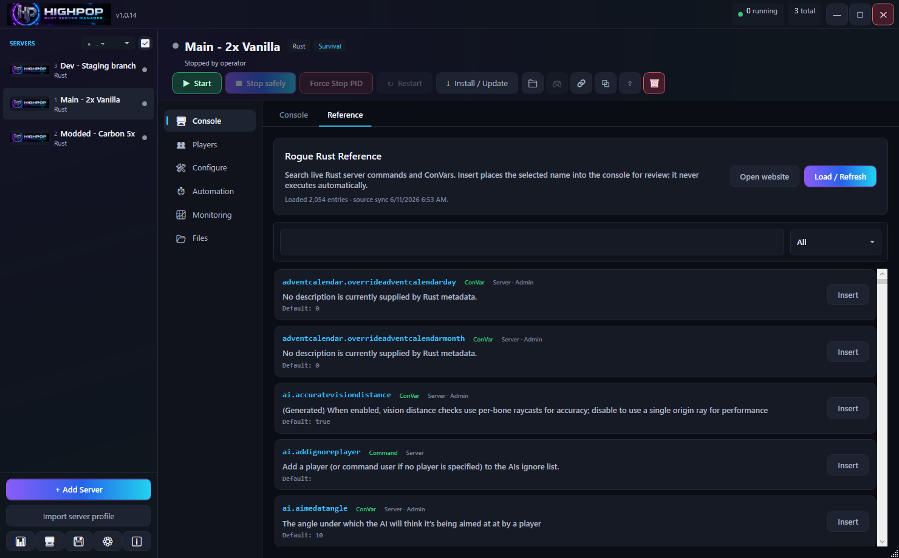

## Quick start

1. Download the latest **HPRM ZIP** from [Releases](../../releases/latest) and, if you like, check it against the `.sha256` file.
2. Extract the whole `HPRM` folder somewhere writable, for example `C:\HPRM`.
3. Run `HighPop.exe` and select **+ Add Server**. HighPop suggests four free ports (game, query, WebRCON, Rust+).
4. Select **Install / Update** to download SteamCMD and Rust, then select **Start**.

HighPop is self-contained, so no .NET install is needed. It runs on Windows 10/11 and Windows Server 2012–2025. Windows SmartScreen may warn about an unsigned community build. Administrator rights are only needed for firewall and URL reservation changes.

## A look around

### Server workspace

Each server has a sidebar with six groups. Pages are built the first time you open them, so switching servers is instant.

| Group | Pages |
|---|---|
| 🖥 **Console** | Live console, Rust command reference |
| 👥 **Players** | Playing now, player tools, chat & reports, moderation, history, statistics, activity |
| 🛠 **Configure** | Server settings, Rust settings, config files, mods |
| ⏱ **Automation** | Lifecycle rules, schedule, backups, log watcher |
| 📈 **Monitoring** | Server info, charts, action log |
| 📂 **Files** | File browser for the server folder |

<table>
  <tr>
    <td width="50%">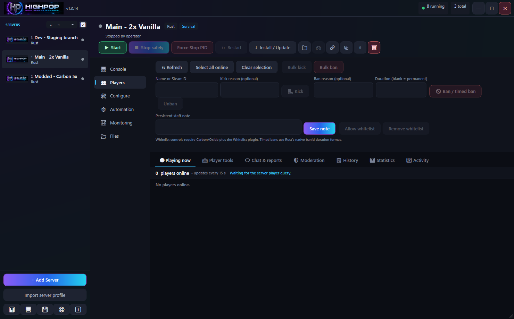 <b>Players</b>: kick, timed bans, staff notes, whitelist and bulk moderation, plus live chat and F7 reports.</td>
    <td width="50%">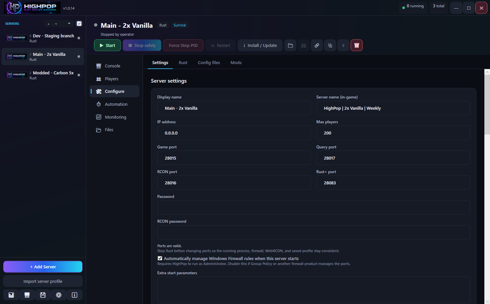 <b>Configure → Settings</b>: name, ports with live validation, passwords and launch options.</td>
  </tr>
  <tr>
    <td>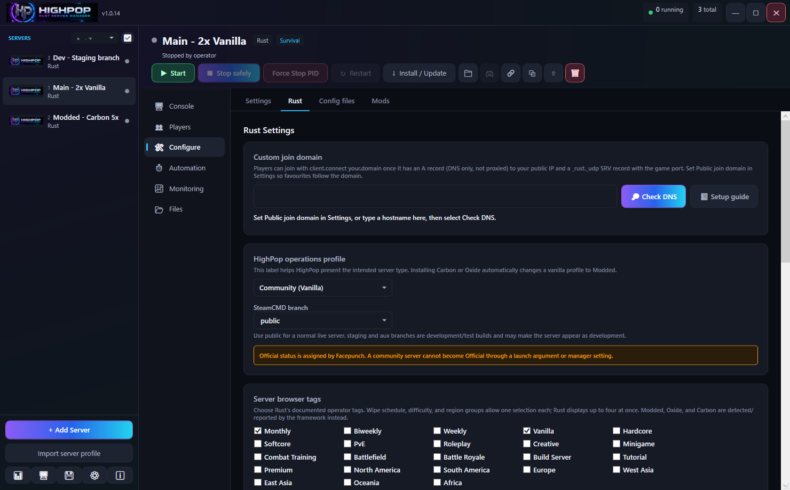 <b>Configure → Rust</b>: custom join domain with DNS check, Steam branch and server browser tags.</td>
    <td>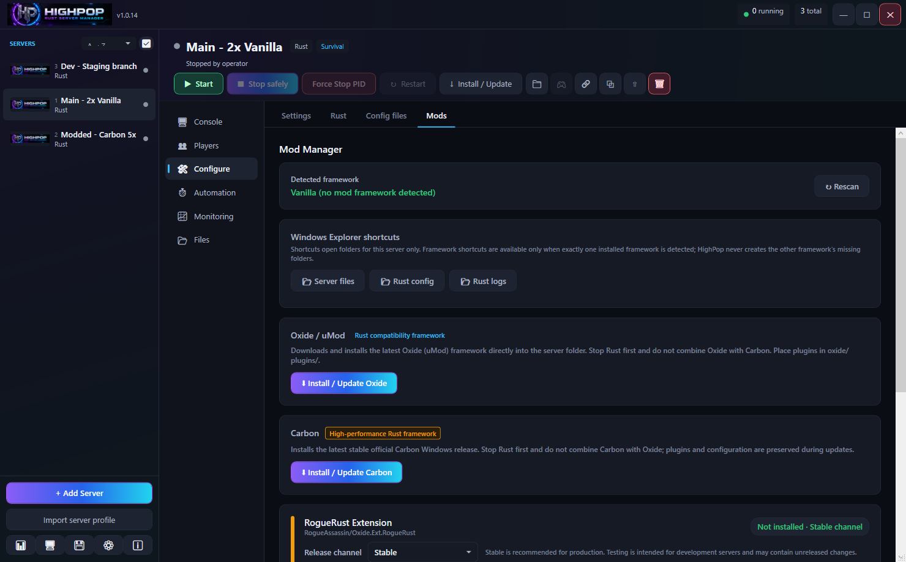 <b>Configure → Mods</b>: one-click Oxide or Carbon, the RogueRust extension and the plugin catalog.</td>
  </tr>
  <tr>
    <td>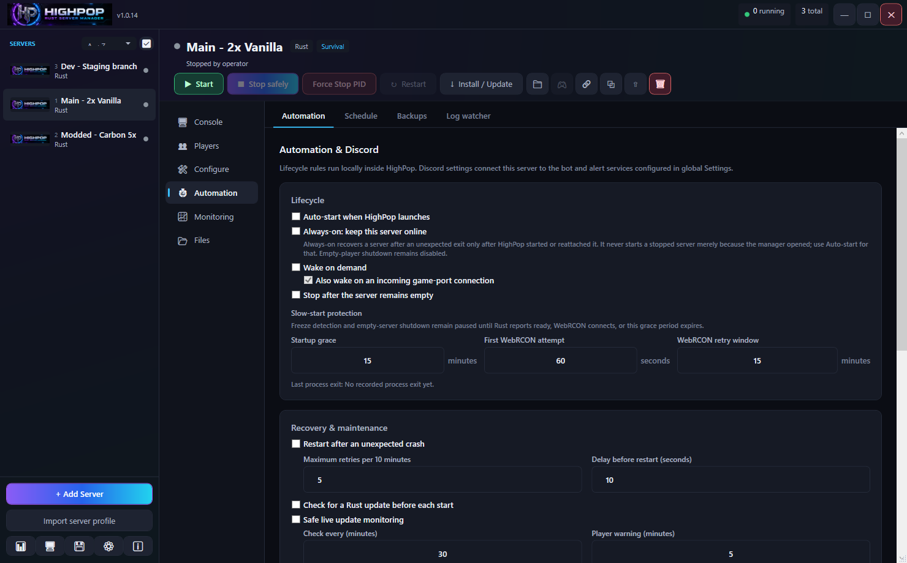 <b>Automation</b>: auto-start, always-on recovery, wake on demand, crash restarts and safe live updates.</td>
    <td>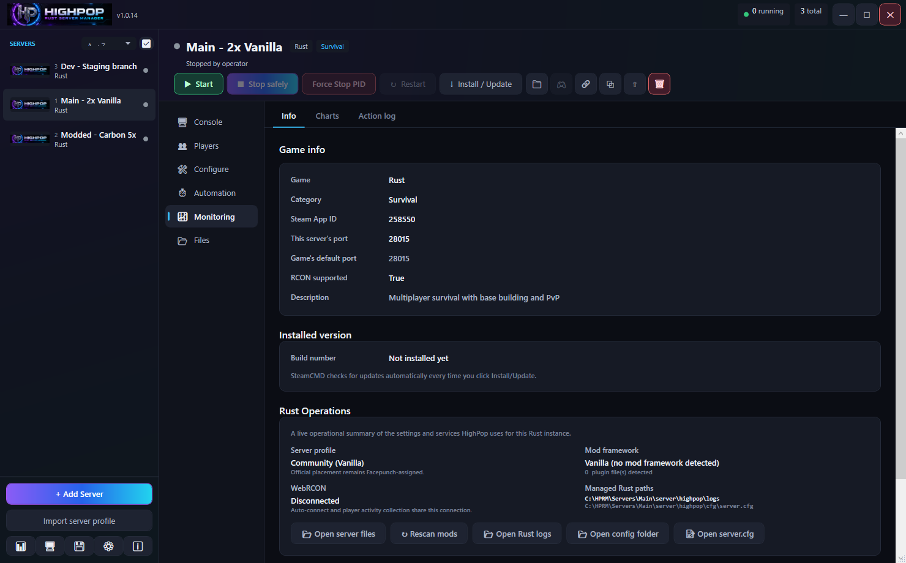 <b>Monitoring → Info</b>: installed build, mod framework, WebRCON state and shortcuts to logs and config.</td>
  </tr>
</table>

### Dialogs and overlays

Actions that need input open over the workspace, so you never lose your place.

<table>
  <tr>
    <td width="62%">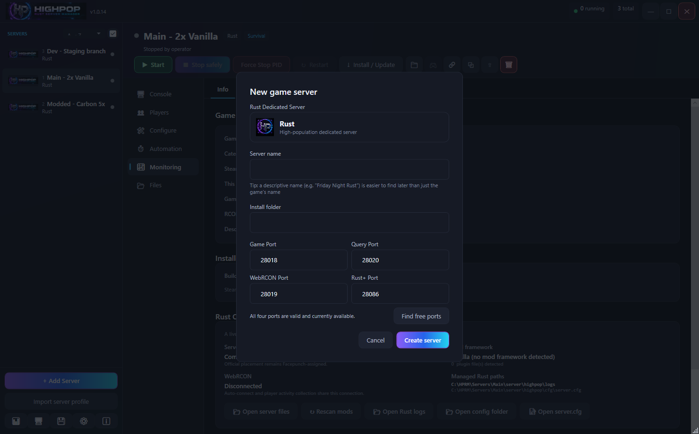 <b>New game server</b>: name, install folder and four ports, checked for clashes as you type, with <b>Find free ports</b>.</td>
    <td width="38%" valign="top">
      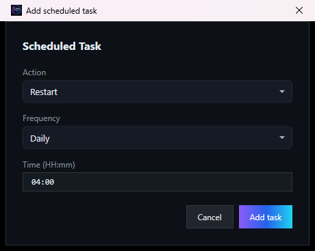 <b>Add scheduled task</b>: restarts, updates, backups, wipes, broadcasts or console commands, once, daily, weekly or repeating.  
      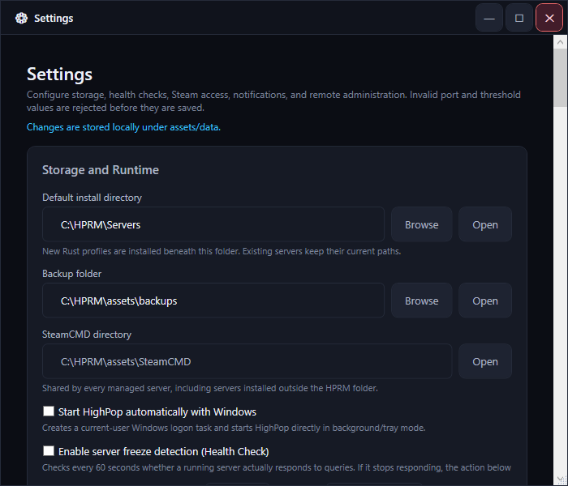 <b>Settings</b>: storage, health checks, Steam, notifications and remote control.
    </td>
  </tr>
</table>

  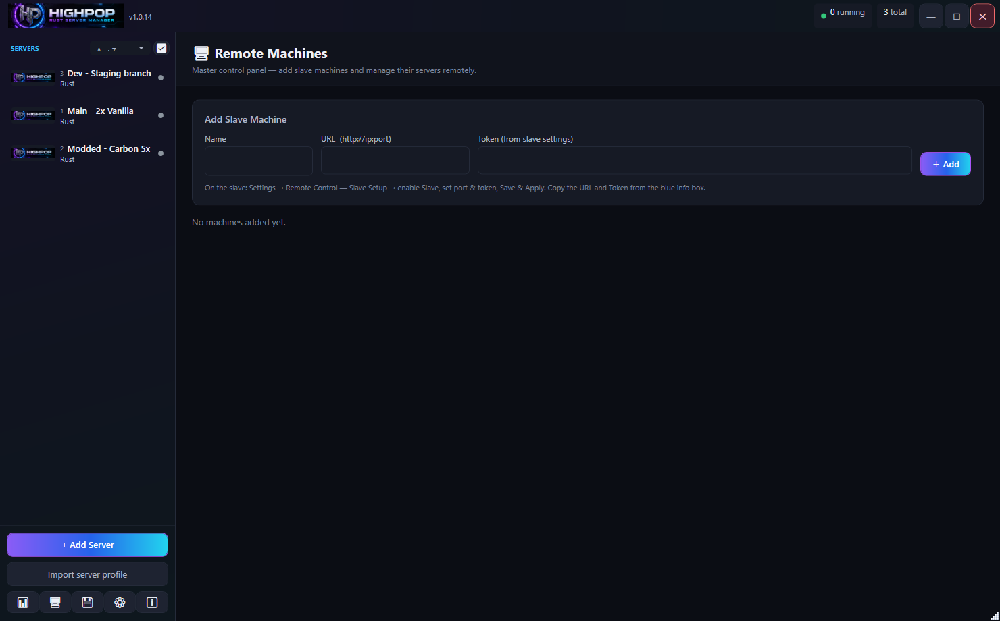 
  <b>Remote Machines</b>: control servers on other PCs running HighPop through its token-protected API.

## Features

| | |
|---|---|
| **Setup** | SteamCMD and Rust install with live progress, independent server folders, templates, port clash checks and profile import/export |
| **Lifecycle** | Start, safe stop (save then quit), force stop, restart, auto-start, always-on recovery, crash-loop protection and reattach after a HighPop restart |
| **Console** | Live filtered console that stays on the newest line (including after RDP reconnects), Command / 💬 Chat switch, delivery-confirmed `say`, export and quick commands |
| **Players** | Live server strip (players, queue, FPS, entities), health, IP, family share and anti-hack flags, give menu, teleport, mute, kill, blueprints, loadouts, bans and notes |
| **Configuration** | `server.cfg` editor that keeps your comments, world size, tags, Steam branch, custom maps, CPU affinity, priority and RAM limits |
| **Mods** | Oxide/uMod and Carbon install and detection, live plugin reload, RogueRust Stable/Testing channels and a one-click plugin catalog |
| **Backups and wipes** | Full and incremental ZIP backups, retention, pre-wipe safety backups, safe restore, map wipe and full wipe |
| **Automation** | Scheduled restarts, updates, backups, wipes, broadcasts and commands, with in-game countdowns |
| **Monitoring** | CPU, RAM, network and player charts, health checks, log watchers, crash warnings and support bundles with secrets removed |
| **Remote** | Optional token-protected REST API and dashboard, Discord status and admin controls, webhooks, email alerts and multi-machine control |
| **Windows** | Portable folder, system tray, start with Windows, firewall rules, optional UPnP and verified in-place updates |
| **Light on resources** | Releases idle memory when minimised to the tray (about 55 MB in testing) and only redraws charts while they are on screen |

## Documentation

| Guide | What it covers |
|---|---|
| [Admin guide](docs/admin-guide.md) | WebRCON, player tools, `server.cfg`, RogueRust channels, plugin catalog, folder layout and production tips |
| [Custom join domains](docs/custom-domains.md) | `client.connect rust.example.com` with DNS steps for Cloudflare, GoDaddy, Namecheap, Route 53 and more |
| [Changelog](CHANGELOG.md) | What changed in every release |
| [Roadmap](ROADMAP.md) | What is planned next |
| [Security](SECURITY.md) | Reporting vulnerabilities and safe deployment |
| [Contributing](CONTRIBUTING.md) | Building from source and sending changes |

### Supported server software

| Component | Support |
|---|---|
| Rust Dedicated Server | Steam `public` and `staging` branches through SteamCMD |
| Carbon | Latest released Carbon framework |
| Oxide/uMod | Latest public Rust build from uMod |
| RogueRust | Stable or Testing channel, chosen per server |

HighPop follows each release channel instead of pinning a build number, so it keeps working as Rust, Carbon and Oxide update.

## Privacy

HighPop runs on your machine and needs no account. It goes online only for the features you use: Steam (SteamCMD), GitHub (HighPop, Carbon and RogueRust downloads), uMod, Discord, Cloudflare DNS and ipify (join-domain check), and the Rogue Gaming hosts `api.roguegaming.com.au` (command reference) and `plugins.roguegaming.com.au` (plugin catalog). Passwords and tokens are encrypted with Windows DPAPI; keep `assets/data` private all the same.

---

HighPop is an independent community project and is not affiliated with or endorsed by Facepunch Studios or Valve. Released under the [MIT license](LICENSE); see [NOTICE.md](NOTICE.md) for attributions.
