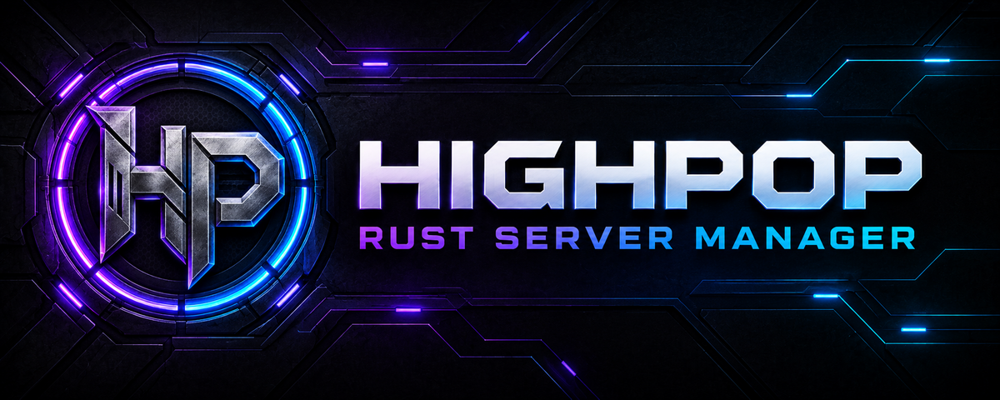

<p align="center">
  
</p>

<p align="center">
  Native, portable Windows management for dedicated Rust servers.
</p>

<p align="center">
  
  
  
  
</p>

HighPop Rust Manager is a local-first control panel built specifically for Rust Dedicated Server. It installs and maintains independent server instances, keeps them online, exposes day-to-day administration in one interface, and does not require a hosted account or subscription.

## What HighPop provides

| Area | Capabilities |
|---|---|
| Server setup | Streamed SteamCMD bootstrap and staged progress, Rust install/validate/update, independent server folders, templates, editable Game/Query/WebRCON/Rust+ ports, and collision checks |
| Lifecycle | Start, safe stop, exact-PID force stop, restart, auto-start, always-on recovery, crash-loop protection, verified process reattachment, and durable operation history |
| Console and players | Facepunch WebRCON with concurrent, non-blocking commands and instant in-game `say`, a shared background channel, reconnect handling, filtered live console that stays pinned to the newest line (including after RDP reconnects and restoring from minimised), Rogue Rust Reference command/ConVar search, export, player sessions, kick, timed/permanent bans, notes, whitelist permissions, and bulk moderation |
| Rust configuration | `server.cfg` variables, browser tags, Steam branch selection, custom maps, log paths, presets, launch arguments, CPU affinity, priority, and optional RAM limits |
| Mods | Oxide/uMod and Carbon installation/detection, framework-aware folders, plugin/config inventory, live plugin reload, verified RogueRust Stable/Testing channels, and one-click install/update from the RogueRust plugin catalog |
| Backups and wipes | Full and incremental ZIP backups, retention, pre-wipe safety backups, path-safe restore, map wipe, and full wipe |
| Automation | Once, daily, weekly, and repeating schedules for lifecycle, update, backup, wipe, broadcast, and console actions |
| Monitoring | CPU, memory, network, players, readiness signals, health checks, log watches, crash-risk warnings, local telemetry, and support bundles with secret redaction |
| Remote operations | Optional token-protected REST API and dashboard, Discord status/admin controls, webhooks, SMTP notifications, and multi-machine views |
| Windows integration | Portable storage, system tray, per-user logon task, Windows Explorer shortcuts, elevation-aware firewall rules, and optional UPnP mappings |
| Profile portability | Per-server HPRM settings export/import, moved-install relinking, conflict-safe port reassignment, and plaintext-secret exclusion |
| Application updates | Startup release check and install prompt, four-hour background checks, manual About-page check, SHA-256 verification, in-place replacement, and automatic restart |

## Install

1. Download the Windows x64 ZIP from [Releases](../../releases).
2. Verify the matching SHA-256 file when provided.
3. Extract the complete `HPRM` folder to a writable location.
4. Run `HighPop.exe`, add a server, review its four ports, and select **Install**.

The application is self-contained; a separate .NET runtime is not required. Windows SmartScreen may warn for unsigned community builds. Administrator rights are only required for system-wide firewall or URL ACL changes. Automatic firewall management can be disabled per server when Group Policy or another firewall product owns the rules.

HPRM v1.0.10 uses .NET 10 and supports Windows 10/11 and Windows Server 2012 through 2025 within Microsoft's supported .NET/Windows lifecycle combinations. The firewall API itself exists on Windows 7 and Windows Server 2008 R2, but the current HPRM runtime does not support those retired operating systems.

### Supported server software

| Component | v1.0.10 support |
|---|---|
| Rust Dedicated Server | Steam public and staging branches through SteamCMD; Vanilla uses the authoritative live Rust logfile |
| Carbon | Current installed/released Carbon framework with process-stream console reporting |
| Oxide/uMod | Latest public Rust build from uMod with authoritative live-log console reporting |
| RogueRust | Independently selectable Stable or Testing channel per server |

HighPop tracks the selected release channel rather than hard-coding a short-lived Rust, Carbon,
Oxide, or RogueRust build number.

## Custom join domains

Players can join with `client.connect rust.example.com` instead of an IP. Rust needs an **A record**
(DNS only — Cloudflare's orange-cloud proxy cannot carry Rust's UDP traffic) to your public IPv4 and one
`_rust._udp` **SRV record** pointing at it with the game port
([Facepunch: Server DNS Records](https://wiki.facepunch.com/rust/dns-records)).

- **Server → Settings → Public join domain** launches Rust with `+server.favoritesEndpoint`, so player
  favourites follow the domain through IP or port changes.
- **Server → 🦀 Rust → Custom join domain → Check DNS** looks the domain up through Cloudflare
  DNS-over-HTTPS and reports missing records, proxied (orange-cloud) or private addresses, a mismatch with
  this network's public IP, wrong SRV ports or targets, and duplicate SRV entries. It shows the exact
  connect command to share.

Step-by-step setup for Cloudflare, GoDaddy, Namecheap, Porkbun, Route 53, Google Cloud DNS and zone
files, plus port forwarding, dynamic IP and hairpin-NAT testing:
[docs/custom-domains.md](docs/custom-domains.md).

## server.cfg and map size

Set the map size with **World size** in Server Settings; HighPop passes it to Rust as
`+server.worldsize`. Leave animal, livestock, sea-life, bird, vehicle, and train `*.population`
convars at their defaults: Rust treats them as densities and multiplies them by the map area and
suitable terrain itself, so the vanilla values already fit every map size. HighPop does not add
population lines to `server.cfg`; any you set yourself are still loaded and editable.

When reading `server.cfg`, a trailing `# comment` or `// comment` is never part of a value, and values
an older tool quoted twice (`"\"1\""`) read as `1`. On save, active lines are written as `name "value"`
and an inline comment is moved to its own line just above.

## Rust command reference

The per-server **Reference** tab loads the current command and ConVar metadata from
[Rogue Rust Reference](https://api.roguegaming.com.au). Search results show execution scope,
descriptions, types, and defaults. **Insert** copies only the selected name into the Console input
for operator review; reference entries are never executed automatically. The compact commands and
ConVars dataset is fetched on demand, shared across server workspaces, and cached for offline use.

## Rogue Gaming endpoints

HighPop only reads from these public Rogue Gaming hosts, over HTTPS, when you use the matching feature:

| Host | Used for |
|---|---|
| `api.roguegaming.com.au` | Rogue Rust Reference command/ConVar metadata (`data/current/*.json`, `data/metadata.json`) |
| `plugins.roguegaming.com.au` | RogueRust plugin catalog, documentation pages, and `.cs` plugin downloads |

## RogueRust plugin catalog

**Server → Mods → RogueRust plugin catalog** lists every plugin published on
[plugins.roguegaming.com.au](https://plugins.roguegaming.com.au) with its category, current version,
and the version installed on that server (read from the plugin's `[Info]` header). **Install**,
**Update**, and **Reinstall** download the single `.cs` file into the active framework's plugins folder
(`oxide/plugins` or `carbon/plugins`). Oxide/Carbon hot-load it, so a running server needs no restart.

Downloads are accepted only from `https://plugins.roguegaming.com.au/plugins/<Name>.cs`, are size-capped,
must be an Oxide/Carbon plugin whose `[Info]` name matches the file, and are swapped in atomically. The
previous file is kept in `highpop-plugin-backups` (newest 5 per plugin). The catalog's plugins require the
RogueRust extension, which is installed from the same tab.

## WebRCON

HighPop keeps one interactive WebRCON connection per server workspace and one shared background channel
for scheduler, broadcast, Web API, Discord, and Oxide stop commands. Commands run concurrently and replies
are matched by identifier, so a slow command never blocks the next one. Rust sends no reply to `say`, so
in-game messages complete as soon as they are sent instead of waiting out a timeout. Connecting sends a
read-only `serverinfo` probe so a wrong RCON password shows as a failed connection instead of a socket
that closes silently. WebRCON output that Oxide's live log does not show (for example RogueRust
diagnostics) is written to the Console tab.

## Portable layout

The release ZIP contains only the application, its assets, and release history:

```text
HPRM/
├─ HighPop.exe
├─ CHANGELOG.md
└─ assets/
   ├─ README.txt
   └─ presets/
```

On first use, HighPop creates runtime data below `assets/` and managed servers below `HPRM/Servers/`:

```text
HPRM/
├─ Servers/          # one independent Rust installation per profile
└─ assets/
   ├─ SteamCMD/      # one shared SteamCMD installation for every server location
   ├─ data/          # settings, profiles, schedules, databases, telemetry
   ├─ backups/       # full and incremental backups
   ├─ logsbackup/    # latest two dated Rust/Oxide/Carbon start archives per server
   └─ logs/          # HighPop diagnostics
```

Before each start or restart, HighPop writes the completed Rust, Oxide, and Carbon logs to a
dated ZIP under `assets/logsbackup/<server>/`. It removes the source logs only after the ZIP is
successfully closed and retains exactly the latest two archives for troubleshooting.

Official presets are embedded in `HighPop.exe` as well as included in the portable ZIP. HighPop
restores missing preset files at startup, updates unchanged built-in presets when their bundled
revision changes, and merges newly introduced keys into edited built-in presets without replacing
operator values. Custom preset files are never changed. Built-in presets a release retires are removed
only while they are still byte-identical to the deployed copy; an edited copy stays as a custom preset.

Keep `HighPop.exe`, `assets`, and `Servers` together when moving or backing up an installation. Secrets are protected with Windows DPAPI for the current Windows user and machine; do not publish `assets/data`.

## RogueRust release channels

Each server has its own RogueRust channel in **Server → Mods**:

- **Stable** is the default and is recommended for production servers.
- **Testing** follows the current RogueRust development build and is intended for development servers.

HighPop reads the selected public channel manifest, validates that it identifies the expected channel, accepts downloads only from the RogueRust public release repository, verifies the DLL's SHA-256, and installs it transactionally. Oxide/uMod uses `RustDedicated_Data/Managed`; Carbon uses `carbon/extensions`. Existing DLLs receive bounded rollback copies.

The selected manifest is also passed to the Rust process, keeping RogueRust self-update checks on that server's chosen channel. Stop Rust before changing the channel or installing the extension.

## Recommended production setup

- Give every profile a unique installation folder and unique Game, Query, WebRCON, and Rust+ ports.
- Leave **Always-on** enabled for production and enable **Auto-start** only when the server should launch with HighPop.
- Use Stable RogueRust on production and Testing only on a separate development profile.
- Configure automatic backups before enabling unattended updates or wipes.
- Use tray/background mode when HighPop must retain live console and process handles.
- Keep the remote API disabled unless it is protected by a trusted LAN, VPN, firewall allow-list, or HTTPS reverse proxy.

## Build from source

Requirements: Windows 10/Server 2019 or newer and the .NET 10 SDK.

```powershell
git clone https://github.com/RogueAssassin/HighPop-Rust-Manager.git
cd HighPop-Rust-Manager
dotnet restore HighPop.sln
dotnet build HighPop.sln -c Release
dotnet run --project HighPop.SmokeTests/HighPop.SmokeTests.csproj -c Release
powershell.exe -NoProfile -ExecutionPolicy Bypass -File .\Build-HighPop.ps1
```

The build script creates the self-contained executable, minimal portable ZIP, checksums, and release manifest under `artifacts/`.

If you are already inside Windows PowerShell and it reports that `Build-HighPop.ps1` is not
digitally signed, use a process-only bypass and then run the script normally:

```powershell
Set-ExecutionPolicy -Scope Process -ExecutionPolicy Bypass
.\Build-HighPop.ps1
```

The `Process` scope lasts only for the current PowerShell window and does not weaken the
machine-wide or current-user execution policy. Do not change `LocalMachine` to `Unrestricted`
just to build HighPop.

## Project information

- [Changelog](CHANGELOG.md) — version-by-version release history
- [Roadmap](ROADMAP.md) — planned reliability, maintenance, interface, telemetry, and service work
- [Security](SECURITY.md) — vulnerability reporting and deployment guidance
- [Contributing](CONTRIBUTING.md) — development workflow
- [Notice](NOTICE.md) — attribution and third-party notices

HighPop is an independent community project and is not affiliated with or endorsed by Facepunch Studios or Valve.

## License

MIT. See [LICENSE](LICENSE).
